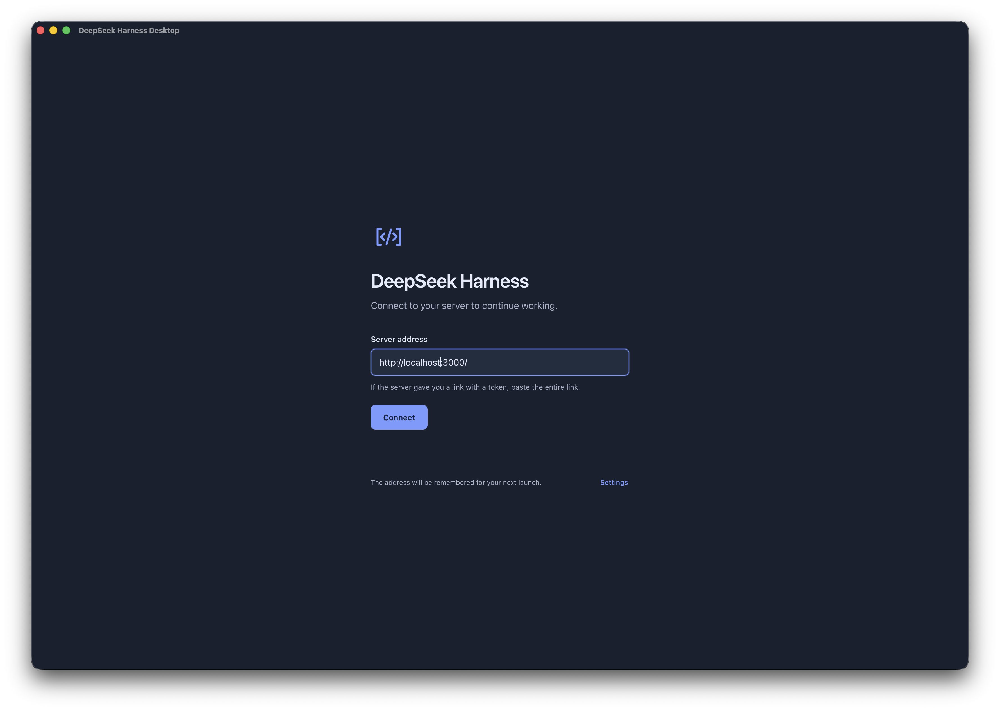
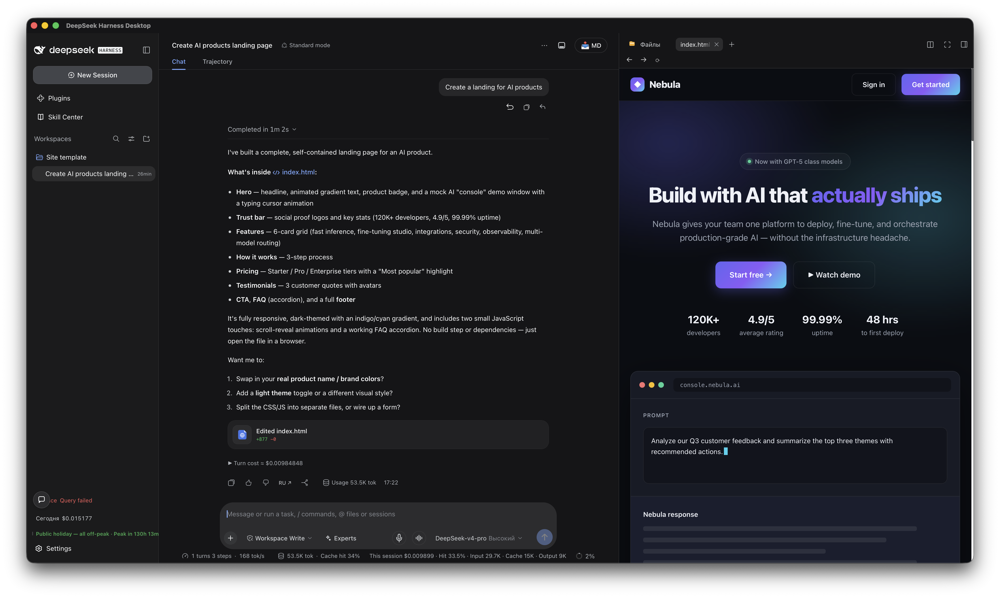

# DeepSeek Harness Desktop

**English** · [Русский](README.ru.md)

A desktop client for local and remote DeepSeek Harness sessions. Connect to a
server running on your computer or on a remote machine. The app opens the server's
web interface in its own window and adds native menus on macOS, Linux and Windows.
The application shell stays within the window: messages and lists scroll inside
their panels while the surrounding interface stays in place.

## Screenshots

**Connection screen on macOS**



**Harness session with a page preview on macOS**



## Connecting

1. Start DeepSeek Harness locally or on a remote machine, or use an existing
   server. If it runs in a container, expose its web port on the host.
2. Open the app and enter the server address: for example, `localhost:3000` for a
   local server or `https://harness.example.com` for a remote server.
3. If the server requires authentication, paste the full link containing `?token=…`
   that it provided at startup. Click **Connect**.

On the next launch, the app suggests the last server address. Query parameters and
URL fragments are not saved; authentication cookies remain in the WebView profile.
Once the session expires, you will need a new full link. The link for a browser on
the host may differ from the address inside the container. `localhost` and
`127.0.0.1` are different authentication hosts: keep the hostname from the link
issued by the server.

Use the **File** menu to change servers (`Cmd/Ctrl+L`) or reset the saved browser
session. **View → Reload** (`Cmd/Ctrl+R`) refreshes the interface. On macOS, closing
the window leaves the app in the Dock; **Window → Show window** or clicking its
Dock icon brings it back. On Linux and Windows, closing the main window exits the
app. On Windows, use the **View** menu or F11 to toggle full screen.

## Application language

English and Russian are available. **System language** is selected by default:
a Russian system language uses the Russian interface, and an English system
language uses English. Other system languages fall back to English. Regional
variants such as `ru-RU` and `en-GB` are also recognized.

Open **Settings…** from the application menu (`Cmd/Ctrl+,`) or the button on the
connection screen. Select **System language**, **English** or **Русский**. Changes
apply immediately and persist across restarts; the server connection stays active.
This setting translates the connection screen, settings, menus, error messages and
client dialogs. The server's web interface manages its language within Harness.

## Development

Use npm and the Node.js version in `.node-version`. Rust, including Clippy and
rustfmt, is pinned in `rust-toolchain.toml` and installed through rustup. On macOS,
install Command Line Tools (`xcode-select --install`); the target is macOS 14+ on
Apple Silicon. The scripts automatically use a Rust installation in `.tools`
when present; otherwise, they use the system `cargo`.

```sh
npm ci
npm run desktop:dev
```

Linux requires WebKitGTK 4.1 and the native tools in the
[official Tauri prerequisites](https://v2.tauri.app/start/prerequisites/).
The baseline environment is Ubuntu 22.04/Debian 12 on x86_64.

For Windows 10/11 x64, install Visual Studio Build Tools with the
**Desktop development with C++** workload, rustup with the
`x86_64-pc-windows-msvc` toolchain, and Microsoft Edge WebView2 Runtime. MSI builds
also require the VBScript feature to be enabled. See the
[Tauri prerequisites](https://v2.tauri.app/start/prerequisites/).
The `npm ci`, `desktop:dev`, `check` and `native:check` commands work in PowerShell
without Bash. The `fixture` and `ci:check` commands also require Python 3.9+ in PATH.

```sh
npm run check
npm run native:check
npm run audit
npm run desktop:build
```

macOS `.app`/`.dmg`, Linux `.deb`/`.AppImage` and Windows `.exe`/`.msi` bundles are
written to `src-tauri/target/release/bundle/`. macOS builds use ad-hoc signing.
Apple Developer ID signing,
notarization and automatic updates are not configured.
Windows packages do not have Authenticode signatures yet.
Packages and diagnostic files are generated locally or in GitHub Actions and
are excluded from Git.

The icon source is `assets/app-icon.svg`; `npm run icons` regenerates PNG, ICNS and
ICO files. The pinned DeepSeek whale source is recorded in the
[SVG](assets/app-icon.svg); its license is in [LICENSE-deepseek](assets/LICENSE-deepseek).

### Building Linux packages in Docker on a Mac

```sh
npm run linux:build
```

This command runs Rust and frontend checks, the GTK dialog test, installed-DEB
tests under Xvfb, language/settings tests, and the packaged AppRun extracted from
the AppImage. Packages, SHA-256 checksums and WebView screenshots are saved in
`artifacts/linux/`. Source files are copied into the image; macOS tools are
excluded. x86_64 emulation on Apple Silicon slows down the build.
If the AppImage tool's loader is incompatible with emulation, the build runs the
same official plugin from its extracted AppDir; its SHA-256 is pinned in the script.

On Linux, install the DEB with `sudo apt install ./package.deb`. For an AppImage,
make it executable (`chmod +x app.AppImage`) and run it. If FUSE is unavailable,
use `app.AppImage --appimage-extract-and-run`.

### Building and installing on Windows

On Windows, run `npm ci`, then `npm run windows:build`. The command builds an
NSIS `.exe` and WiX `.msi`, checks package architecture and version, and saves them
with SHA-256 checksums in `artifacts/release-windows-x86_64/`. Python is required
to prepare metadata. Move the previous artifacts directory before building again.

The recommended `*-setup.exe` installer installs the app for the current user and
offers English and Russian. MSI uses an English installer interface and may
require administrator privileges. In both cases, the application's language
follows the system or the user's setting.

The installers include the WebView2 bootstrapper. If the runtime is missing or too
old, installing it requires an internet connection. Download the package from the
artifacts of a successful Windows job or from a GitHub Release. Windows may warn
about an unknown publisher because signing is not configured yet.

## GitHub Actions

CI checks pull requests and commits, builds macOS arm64 (`.app`/`.dmg`), Linux
x86_64 (`.deb`/`.AppImage`) and Windows x64 (`.exe`/`.msi`), and saves packages,
SHA-256 checksums and diagnostics. Pushing a `v<version>` tag runs the same checks
and creates a **draft** release. The current builds do not require additional secrets.

Repository setup, the required `CI required` check, version preparation and
publishing are documented in [docs/github-actions.md](docs/github-actions.md).

## Authentication and native behavior checks

`npm run fixture` starts a local test server on port 4317. Its public test link is
`http://localhost:4317/?token=fixture-token`. The server reproduces
303 → HttpOnly/SameSite=Strict cookie → protected API/WebSocket authentication.
The page includes IPC checks, file selection, downloads, an external URL and
cookie expiry controls.
To test the fixed application shell, use
`http://localhost:4317/shell?token=fixture-token`: long lists and code scroll
independently while the header and input remain visible. This page also checks
delayed root-element mounting and a strict server CSP.

The test matrix and actual results are in [docs/verification.md](docs/verification.md).
Trust boundaries and window behavior are described in
[docs/architecture.md](docs/architecture.md).
The remote web client cannot access Rust commands, files or process execution.
HTTPS certificates are validated; configure OS trust for a custom CA.

Authentication follows the
[DeepSeek Harness mechanism](https://github.com/deepseek-ai/deepseek-harness/blob/master/packages/client/connection/README.md).
